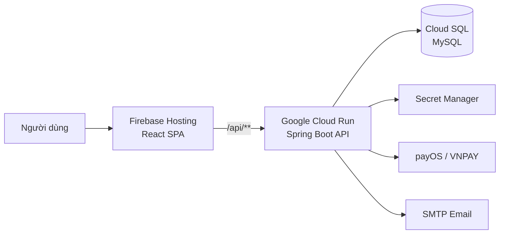

<div align="center">

# CleanMarket

**Nền tảng thương mại điện tử nông sản sạch, minh bạch nguồn gốc và kết nối trực tiếp người mua với nhà cung cấp.**

[](https://react.dev/)
[](https://spring.io/projects/spring-boot)
[](https://openjdk.org/)
[](https://www.mysql.com/)
[](https://firebase.google.com/)
[](https://cloud.google.com/run)

[Website](https://cleanmarket.io.vn) · [Website dự phòng](https://project-7180b607-0de7-493c-969.web.app) · [Báo lỗi](https://github.com/nampt24102004/EXE201_CleanMarket/issues)

</div>

## Giới thiệu

CleanMarket là hệ thống marketplace dành cho nông sản và thực phẩm sạch. Nền tảng hỗ trợ toàn bộ quy trình từ đăng ký nhà cung cấp, quản lý và kiểm duyệt sản phẩm, truy xuất lô hàng bằng QR, mua hàng, thanh toán, theo dõi đơn đến xử lý khiếu nại và hoàn tiền.

Dự án được xây dựng theo mô hình full-stack, gồm giao diện React, REST API Spring Boot và cơ sở dữ liệu MySQL. Bản production được triển khai trên Firebase Hosting và Google Cloud.

## Chức năng nổi bật

### Người mua

- Đăng ký, đăng nhập, xác minh email và khôi phục mật khẩu.
- Tìm kiếm, xem danh mục, sản phẩm và thông tin nhà cung cấp.
- Xem nguồn gốc sản phẩm theo mã truy xuất của từng lô hàng.
- Quản lý giỏ hàng, địa chỉ nhận hàng và lịch sử đơn hàng.
- Thanh toán COD, VNPAY hoặc payOS/VietQR.
- Đánh giá sản phẩm, gửi khiếu nại và theo dõi yêu cầu hoàn tiền.

### Nhà cung cấp

- Quản lý hồ sơ và giấy tờ nhà cung cấp.
- Đăng sản phẩm để gửi duyệt.
- Tạo lô hàng, chứng nhận và mã QR truy xuất nguồn gốc.
- Theo dõi các đơn thuộc nhà cung cấp và cập nhật tiến trình xử lý.

### Manager

- Duyệt hoặc từ chối hồ sơ nhà cung cấp và sản phẩm.
- Quản lý đơn hàng, khiếu nại và yêu cầu hoàn tiền.
- Kiểm tra chứng nhận và dữ liệu truy xuất.

### Administrator

- Quản lý tài khoản, vai trò và trạng thái người dùng.
- Quản lý danh mục sản phẩm.
- Theo dõi nhật ký hoạt động của hệ thống.

## Công nghệ sử dụng

- **Frontend:** React 19, Vite 8, React Router, React Bootstrap.
- **Backend:** Java 25, Spring Boot 3.5, Spring Security, Spring Data JPA, Bean Validation.
- **Database:** MySQL 8; H2 dùng trong kiểm thử.
- **Thanh toán:** payOS/VietQR và VNPAY.
- **Truy xuất:** ZXing tạo mã QR theo lô sản phẩm.
- **Tài liệu API:** OpenAPI và Swagger UI trong môi trường phát triển.
- **Production:** Firebase Hosting, Cloud Run, Cloud SQL và Secret Manager.

## Kiến trúc production



Firebase Hosting phục vụ ứng dụng React và chuyển tiếp mọi request `/api/**` tới Cloud Run. Backend kết nối Cloud SQL bằng Cloud SQL Connector; thông tin nhạy cảm được lưu trong Secret Manager thay vì mã nguồn.

## Cấu trúc thư mục

```text
EXE201_CleanMarket/
├── frontend/        # React SPA
├── backend/         # Spring Boot REST API
├── database/        # Dữ liệu mẫu và migration SQL
├── firebase.json    # Cấu hình Firebase Hosting và Cloud Run rewrite
├── start-dev.ps1    # Khởi động frontend và backend trên Windows
└── README.md
```

Backend được tổ chức theo từng nhóm nghiệp vụ trong `backend/src/main/java/com/app/features`, gồm `auth`, `user`, `suppliers`, `catalog`, `products`, `traceability`, `cart`, `orders`, `payments`, `feedback`, `audit` và `admin`.

## Chạy dự án trên máy cá nhân

### Yêu cầu

- JDK 25
- Node.js 22 trở lên và npm
- MySQL 8
- Git

### 1. Tải mã nguồn

```bash
git clone https://github.com/nampt24102004/EXE201_CleanMarket.git
cd EXE201_CleanMarket
```

### 2. Cấu hình backend

Tạo file môi trường từ mẫu có sẵn:

```powershell
Copy-Item backend/.env.example backend/.env
```

Trên macOS hoặc Linux:

```bash
cp backend/.env.example backend/.env
```

Mở `backend/.env` và cấu hình tối thiểu:

```properties
DB_URL=jdbc:mysql://localhost:3306/cleanmarket_db?createDatabaseIfNotExist=true
DB_USERNAME=root
DB_PASSWORD=your_mysql_password
FRONTEND_BASE_URL=http://localhost:5173
CORS_ORIGINS=http://localhost:5173
```

Không commit file `.env` hoặc bất kỳ khóa thanh toán, mật khẩu SMTP và mật khẩu cơ sở dữ liệu nào lên GitHub.

### 3. Khởi động backend

Windows:

```powershell
cd backend
.\mvnw.cmd spring-boot:run
```

macOS/Linux:

```bash
cd backend
./mvnw spring-boot:run
```

Backend chạy tại `http://localhost:8080`. Swagger UI có tại `http://localhost:8080/swagger-ui.html`.

### 4. Khởi động frontend

Mở terminal khác:

```bash
cd frontend
npm install
npm run dev
```

Truy cập `http://localhost:5173`. Vite sẽ chuyển tiếp `/api` tới backend ở cổng `8080`.

Trên Windows, sau khi đã tạo `backend/.env` và cài dependencies frontend, có thể khởi động cả hai ứng dụng bằng:

```powershell
.\start-dev.ps1
```

## Dữ liệu demo

Đặt các biến sau trong `backend/.env` nếu muốn backend tự tạo dữ liệu phục vụ phát triển:

```properties
DEMO_SEED=true
DEMO_PASSWORD=your_demo_password
```

Seeder tạo các tài khoản mẫu cho vai trò `USER`, `PARTNER`, `MANAGER`, `ADMIN` cùng nhà cung cấp, sản phẩm và lô truy xuất. Không bật `DEMO_SEED` trong production. Xem thêm hướng dẫn tại [`database/README.md`](database/README.md).

## Kiểm thử và build

Chạy kiểm thử backend:

```powershell
cd backend
.\mvnw.cmd test
```

Kiểm tra và build frontend:

```bash
cd frontend
npm run lint
npm run build
```

Các bài test backend sử dụng H2 nên không yêu cầu MySQL. Test hiện bao phủ xác thực, checkout nhiều nhà cung cấp, tồn kho, quyền sở hữu lô hàng và các luồng thanh toán payOS.

## Bảo mật

- Xác thực dựa trên session cookie với `HttpOnly`, `Secure` và `SameSite` trong production.
- CSRF token bắt buộc đối với các request làm thay đổi dữ liệu.
- Phân quyền theo vai trò `USER`, `PARTNER`, `MANAGER`, `ADMIN`.
- Mật khẩu được băm trước khi lưu trữ.
- Webhook thanh toán được kiểm tra chữ ký và xử lý idempotent.
- Secret production không được lưu trong repository.

Nếu phát hiện vấn đề bảo mật, không đăng thông tin nhạy cảm trong issue công khai. Hãy liên hệ trực tiếp với nhóm phát triển.

## Triển khai production tự động

Production hoạt động tại [https://cleanmarket.io.vn](https://cleanmarket.io.vn). Frontend được phát hành qua Firebase Hosting; các request `/api/**` được chuyển tiếp tới backend `cleanmarket-api` trên Cloud Run. Backend sử dụng Cloud SQL for MySQL và lấy các thông tin nhạy cảm từ Google Secret Manager.

Workflow [`.github/workflows/deploy-production.yml`](.github/workflows/deploy-production.yml) tự động chạy khi có commit được push hoặc pull request được merge vào nhánh `main`. Thành viên trong nhóm không cần deploy thủ công và không cần tải khóa Google Cloud về máy.

### Quy trình của pipeline

Pipeline `Deploy production` thực hiện lần lượt:

1. Chạy toàn bộ test backend bằng Maven.
2. Chạy lint và build frontend bằng npm/Vite.
3. Build Docker image backend và đẩy image được gắn đúng Git commit SHA lên Artifact Registry.
4. Deploy image mới lên Cloud Run. Backend chạy Flyway migration trước khi Hibernate kiểm tra schema.
5. Deploy frontend mới lên Firebase Hosting và cập nhật rewrite `/api/**` tới revision Cloud Run mới.
6. Gọi API production để smoke test. Chỉ khi tất cả bước đều thành công thì workflow mới có trạng thái xanh.

GitHub Actions xác thực với Google Cloud bằng OIDC/Workload Identity Federation. Repository không lưu service-account key dài hạn. Danh tính deploy chỉ được chấp nhận từ repository này và nhánh `main`.

### Cách đưa thay đổi lên production

1. Tạo branch mới từ `main`, thực hiện thay đổi và commit.
2. Chạy kiểm tra ở máy cá nhân:

   ```powershell
   cd backend
   .\mvnw.cmd test

   cd ..\frontend
   npm ci
   npm run lint
   npm run build
   ```

3. Push branch và tạo pull request vào `main`.
4. Sau khi review, merge pull request. Commit trên `main` sẽ tự kích hoạt pipeline.
5. Theo dõi tab [GitHub Actions](https://github.com/nampt24102004/EXE201_CleanMarket/actions) và chỉ xác nhận phát hành hoàn tất khi workflow `Deploy production` có màu xanh.
6. Kiểm tra nhanh [website production](https://cleanmarket.io.vn) sau khi pipeline hoàn tất.

Không chạy deploy lần thứ hai khi workflow trước vẫn đang thực hiện. Pipeline đã được cấu hình chạy tuần tự để tránh hai commit cùng cập nhật production.

### Thay đổi database production

Flyway tự động áp dụng migration khi revision backend mới khởi động. Khi thay đổi entity hoặc schema:

1. Tạo **migration mới** trong `backend/src/main/resources/db/migration` theo định dạng `V<version>__<mo_ta>.sql`, ví dụ `V20261017__add_order_note.sql`.
2. Đồng bộ một bản của file vào `database/migrations` để lịch sử database trong repository dễ tra cứu.
3. Viết migration theo hướng tiến tới, giữ được dữ liệu hiện có và kiểm tra trên MySQL local trước khi merge.
4. Không sửa, đổi tên hoặc xóa migration đã từng chạy trên production. Nếu cần sửa lỗi, hãy tạo một migration có version mới; nếu sửa file cũ, Flyway sẽ báo checksum không khớp và backend mới không thể khởi động.
5. Không bật `JPA_DDL_AUTO=update` hoặc chạy `cleanmarket_full_data.sql` trên production. Production dùng `JPA_DDL_AUTO=validate`; Flyway là cơ chế duy nhất để thay đổi schema.

Nếu migration hoặc backend mới không khởi động được, Cloud Run không chuyển traffic sang revision lỗi và phiên bản production đang hoạt động vẫn tiếp tục phục vụ. Hãy xem log của bước `Deploy backend to Cloud Run`, sửa bằng migration/commit mới rồi merge lại; không chỉnh trực tiếp database production nếu chưa thống nhất với người quản trị dự án.

### Khi pipeline thất bại

- `Test backend`: sửa test hoặc lỗi compile; không bỏ qua test để deploy.
- `Test and build frontend`: sửa lỗi lint/build và kiểm tra `frontend/package-lock.json` đã được commit.
- `Push backend container` hoặc `Deploy backend to Cloud Run`: kiểm tra log GitHub Actions và Cloud Run; báo người quản trị nếu lỗi liên quan IAM hoặc Secret Manager.
- `Deploy frontend to Firebase Hosting`: kiểm tra log Firebase trong workflow, không deploy thủ công đè lên bản production.
- `Smoke test production`: kiểm tra trạng thái Cloud Run, Firebase Hosting và endpoint `/api/products?page=0&size=1` trước khi chạy lại.

Người có quyền Actions có thể chạy lại workflow bằng `Actions` → `Deploy production` → `Run workflow`, chọn nhánh `main`. Không chạy workflow từ branch tính năng vì danh tính Google Cloud chỉ cho phép deploy từ `main`.

Chi tiết cấu hình backend và API được trình bày trong [`backend/README.md`](backend/README.md).

## Đóng góp

1. Fork repository và tạo branch từ nhánh chính.
2. Thực hiện thay đổi theo phạm vi rõ ràng.
3. Chạy test backend, lint và build frontend.
4. Tạo pull request kèm mô tả và cách kiểm thử.

---

<div align="center">
  CleanMarket — Nông sản sạch, nguồn gốc minh bạch.
</div>
